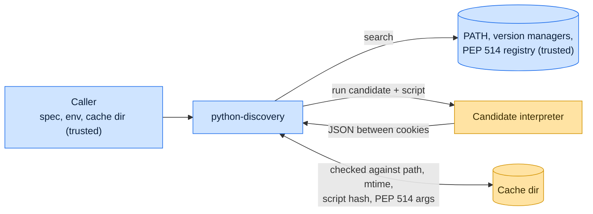

# Threat model

This model says what python-discovery trusts, where untrusted input enters, and which guarantees hold at each boundary,
so a report can be classified as a vulnerability or a bug. [SECURITY.md](SECURITY.md) covers reporting; if the two
disagree, SECURITY.md wins and we fix this file.

## How python-discovery works

A caller passes a requirement such as `python3.12` or `>=3.11,<3.13`. python-discovery walks `try_first_with` paths, the
running interpreter, the PEP 514 registry on Windows, `PATH` (resolving pyenv, mise and asdf shims to the binary they
select), and uv's install directories. It runs each candidate with a bundled interrogation script and reads a JSON
answer framed by two random cookies, then caches that answer in a directory the caller supplies, valid while the
binary's path and modification time, the script's hash and any PEP 514 arguments stay the same.

## Compared with similar tools

We drew the boundary where comparable projects in other ecosystems draw theirs. The shared rule, stated by the
[Node.js threat model](https://github.com/nodejs/node/blob/main/SECURITY.md#the-nodejs-threat-model), is that a report
which first needs a trusted element compromised is out of scope; the first triage question, as
[DOMPurify](https://github.com/cure53/DOMPurify/blob/main/SECURITY.md#what-we-consider-a-vulnerability) puts it, is what
the attacker controls.

| Project                                                                | Language | Where it draws the line                                                                                                       |
| ---------------------------------------------------------------------- | -------- | ----------------------------------------------------------------------------------------------------------------------------- |
| [Go `os/exec` path lookup](https://go.dev/blog/path-security)          | Go       | Refuses to run a binary found through the current directory; python-discovery skips empty `PATH` entries for the same reason. |
| [nvm](https://github.com/nvm-sh/nvm/blob/HEAD/.github/THREAT_MODEL.md) | Shell    | Trusts what it installs and executes as the user; treats mirror metadata, not payloads, as the untrusted boundary.            |
| [uv](https://github.com/astral-sh/uv/security/policy)                  | Rust     | Its policy says invoking the Python interpreters it finds, to read their metadata, is not a vulnerability.                    |

## Trusted

An attacker who controls any of these already has what python-discovery could give them:

- The caller and the spec, environment mapping, cache directory and `try_first_with` paths it passes.
- Every directory searched: `PATH` entries, version-manager roots and install directories, and the PEP 514 registry,
  including `ExecutableArguments`.
- The interpreters found there; running them is how discovery works.
- A cache directory that only the caller can write (for example virtualenv's app-data).

## Untrusted inputs

| Input                         | Comes from                                          | What python-discovery guarantees                                                                               |
| ----------------------------- | --------------------------------------------------- | -------------------------------------------------------------------------------------------------------------- |
| The current working directory | Wherever the caller happens to run                  | Empty `PATH` components, which shells read as the current directory, are skipped.                              |
| Interrogation stdout          | Startup noise or a `sitecustomize` that prints      | Only the JSON between two per-run random cookies is parsed; anything else is a failed candidate.               |
| Cache entries                 | Earlier runs, possibly of another interpreter build | Reused only when the binary's path and modification time, the script hash and the PEP 514 arguments all match. |
| A shared cache directory      | Another local user who can write it                 | Must not make a victim accept an interpreter or metadata that discovery would reject; report any way it does.  |

## Threats and controls

| STRIDE                 | Threat                                                                  | Control                                                                                        |
| ---------------------- | ----------------------------------------------------------------------- | ---------------------------------------------------------------------------------------------- |
| Spoofing               | Output printed by a candidate's startup code impersonates its metadata. | Random start and end cookies frame the answer.                                                 |
| Tampering              | A stale cache entry describes a binary that has since been replaced.    | The entry records the binary's modification time, the script's hash and the PEP 514 arguments. |
| Denial of service      | A candidate hangs during interrogation.                                 | The interrogation has a timeout, configurable with `PY_DISCOVERY_TIMEOUT`.                     |
| Elevation of privilege | A binary in the current directory is picked up through `PATH`.          | Empty `PATH` entries are skipped.                                                              |

## Release chain

Releases run on the shared [tox-dev/github-workflows](https://github.com/tox-dev/github-workflows) pipeline. A release
App, not a person, pushes the release commit and tag; the build installs its tools from a hash-checked `pylock.toml`
resolved with a seven-day upload cooldown by default; PyPI receives the files through
[trusted publishing](https://docs.pypi.org/trusted-publishers/) with attestations, and the GitHub Release is immutable.
Every workflow pins third-party actions to a commit SHA.

## Vulnerability or bug

| Report                                                                      | Verdict             | Why                                                                                                  |
| --------------------------------------------------------------------------- | ------------------- | ---------------------------------------------------------------------------------------------------- |
| A `python3` in the working directory runs because `PATH` ends with `:`      | Vulnerability       | The empty entry must not reach the current directory.                                                |
| A `pyenv` shim that is malware runs during discovery                        | Not a vulnerability | Searched locations are trusted.                                                                      |
| A cached answer for `/usr/bin/python3` is returned after the OS upgraded it | Bug                 | Cache correctness, crossing no boundary; a vulnerability only if it can point at a different binary. |
| `PY_DISCOVERY_TIMEOUT=inf` lets a hung interpreter block forever            | Not a vulnerability | The environment is trusted and the value is documented.                                              |

## Severity

- **High:** argument handling runs a separate command the attacker chose, or another local user poisons a shared cache
  so a victim runs an interpreter outside the requested constraints, without control of the victim's `PATH`, registry or
  interpreters.
- **Medium:** cache poisoning changes security-relevant metadata without execution, or a small candidate response causes
  sustained memory or process exhaustion.
- **Low:** the wrong interpreter selected without crossing a privilege boundary, a crash on malformed output, or stale
  metadata from a cache only the caller writes.

## Accepted risks

- Discovery executes every candidate it considers; it cannot learn an interpreter's version without running it.
- PEP 514 `ExecutableArguments` are raw command-line text from the registry, passed to the candidate as written, without
  a shell.

## Keeping this current

Revisit this model when python-discovery gains a new input source, network access, a new way to run code, or a new place
it writes to, and whenever an advisory is published.
